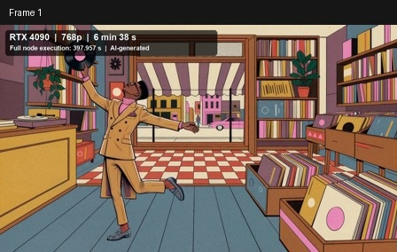

# Pika-H3-Flex-4090

**An unofficial, measured ComfyUI integration for local Pika H3 Flex on an RTX 4090.**

[中文说明](docs/4090/README_zh.md) · [Install](docs/4090/INSTALL.md) · [Optimizations](docs/4090/OPTIMIZATIONS.md) · [Benchmarks](docs/BENCHMARKS.md) · [Contributing](CONTRIBUTING.md)

This fork adds a small ComfyUI extension, reproducible workflows, numerical tests and benchmark tools. It does **not** introduce a new model, claim official affiliation, redistribute weights, or promise unrestricted model use. Powered by MiniMax H3; the model, adapters and encoder remain their respective authors' work.

The original Pika-Labs standalone source is preserved in `src/`; its [archived README](README_UPSTREAM.md), H100-oriented Docker/Conda recipes and [standalone requirements](requirements-standalone.txt) are **not the 4090 deployment route**.

## What is actually verified?

- Text-to-video **and audio**, 1344×768, **362 frames at 24 fps** (15.083 seconds).
- Official Comfy-Org pruned INT8 ConvRot H3 base, Qwen NVFP4 AWQ encoder, INT8 video VAE, FP32 audio VAE, and Pika FL2VA LoRA.
- The official **six model evaluations**, BasicGuider, LCM and prescribed manual sigmas. No reduced frame count, step skipping, sparse attention or replacement LoRA in the recommended preset.
- Windows / RTX 4090 24 GB / 64 GB RAM. Other GPUs, Linux, portable installations and first/last-frame image conditioning are not performance-qualified. A single multimodal Ref2VA case has been separately measured below; arbitrary reference combinations are not qualified.

| Recorded configuration | Full request seconds | Result-cache hits |
|---|---:|---|
| Earlier native bypass + FFN16384 baseline, run 1 | 376.127 | None |
| Earlier baseline, new-process repeat | 378.028 | None |
| This extension, low-peak LoRA + native activation, development run | 370.639 | None |
| Low-peak LoRA + Triton SwiGLU, development run | 370.109 | None |
| Final frozen-source default, new-process repeat | **379.497** | None |

The small difference between the two development runs is **not evidence of a significant end-to-end speedup**. Complete candidate results, repetitions, numerical differences and exact measurement limits are recorded in [the benchmark report](docs/BENCHMARKS.md), not inferred from kernel microbenchmarks.

Timing is ComfyUI `execution_start → execution_success`: actual request loading, encoding, six-step sampling, audio/video decoding and MP4 saving. It excludes installation and server startup; OS files and compiler/kernel caches may be warm. Do not compare it directly with an unspecified social-media timing boundary. Two runs of the older configuration are historical evidence, not repeated trials of every new candidate.

## Ref2VA: image, video and audio references

A separate RTX 4090 test used Pika's [official Record-shop dance demonstration](https://huggingface.co/Pika-Labs/Pika-H3-Flex/resolve/0ddf55ad7067ca1e76812253bd7b4600df87f759/assets/showcases/motion-transfer.mp4): two reference images plus one reference video and its soundtrack. At **1344×768, 243 frames / 10.125 seconds**, one fresh-process request took **397.957 seconds (6 min 38 s)**. The 864×480 version took 190.218 seconds. These are single observations with no node-result cache, not a repeated benchmark or a 15-second result.

A separate 480p run routed audio extracted from that same reference video into the independent-audio input and completed in 190.815 seconds. This is a derived interface test, not an independent official audio sample. All three outputs decoded with non-silent stereo audio; no subjective audio audition was performed. The local sample retained the shop and broad dance scene, but failed to preserve the official character's animal face and striped tail in the inspected frames.

### Demo: official vs. RTX 4090

| Official Pika-Labs showcase | Local RTX 4090 output (AI-generated) |
|:---:|:---:|
| [](https://huggingface.co/Pika-Labs/Pika-H3-Flex/resolve/0ddf55ad7067ca1e76812253bd7b4600df87f759/assets/showcases/motion-transfer.mp4) | [](https://github.com/ling5717/Pika-H3-Flex-4090/raw/main/assets/demos/ref2va-4090-labeled.mp4) |
| [▶ Watch official video](https://huggingface.co/Pika-Labs/Pika-H3-Flex/resolve/0ddf55ad7067ca1e76812253bd7b4600df87f759/assets/showcases/motion-transfer.mp4) | [▶ Watch local result with audio](https://github.com/ling5717/Pika-H3-Flex-4090/raw/main/assets/demos/ref2va-4090-labeled.mp4) |

The local video is labelled **RTX 4090 · 768p · 6 min 38 s**, corresponding to **397.957 s complete node execution** for 243 frames at 24 fps and six evaluations. Timing includes reference encoding, sampling, audio/video decoding and saving; it excludes server startup. This is one local run. The official demo's seed, generating checkpoint, preprocessing and runtime are undisclosed, so the two videos are a qualitative comparison, not a controlled benchmark or exact reproduction.

The [Ref2VA guide](docs/4090/REF2VA.md) contains the input links, model and LoRA hashes, workflow instructions and limitations. The repository owner confirmed separate authorization for public display of this local result; that does **not** grant viewers additional rights. Review the [MiniMax H3 license](LICENSE), including its territorial and output-display restrictions.

## Quick start

Use a **separate ComfyUI environment**. Read the model license, install the [tested ComfyUI/CUDA 13 stack](docs/4090/INSTALL.md), then clone this repository into its custom nodes:

```bash
cd ComfyUI/custom_nodes
git clone https://github.com/ling5717/Pika-H3-Flex-4090.git
```

The root `requirements.txt` intentionally adds no mandatory packages to an existing ComfyUI. **Do not run `pip install -e .` for this extension**: the preserved root Python distribution is the separate upstream standalone pipeline.

Place the five [exact model components](configs/models.json) in ComfyUI's standard model folders, or use its normal extra-model-paths configuration. Verify them without downloading or changing anything:

```bash
python custom_nodes/Pika-H3-Flex-4090/tools/verify_models.py --model-root models
```

Launch from the ComfyUI directory:

```bash
python main.py --listen 127.0.0.1 --port 8189 --offline --use-ck-attention --reserve-vram 3.5
```

Load [the UI workflow](workflows/t2v-768p-15s.json), or use [the API graph](workflows/api-t2v-768p-15s.json). Open the UI subgraph to change optional optimization settings. Start with the conservative defaults; native loaders and samplers remain native.

The nodes are:

- **Pika H3 Low-Peak LoRA** (`PikaH3LowPeakLoRA`): ordinary linear LoRA, complete native key mapping, no model-weight merge. Default `low_peak`; optional `addmm` changes low-precision rounding.
- **Pika H3 FFN Optimization** (`PikaH3Optimize`): 8192/16384/32768-token FFN chunks; default 16384, native activation. Optional Triton SwiGLU, tensor-only compilation, and fused RMS/AdaLN are explicit experiments rather than unconditional recommendations.

Strict candidate modes report unsupported configurations instead of silently benchmarking a fallback. All model modifications are execution-scoped ModelPatcher injections with restoration; no global replacement of Comfy operations and no core-source patching.

## Official showcase comparison

For a separate 328-frame, 13.67-second prompt-matched test, we compared the [official Pika-Labs showcase](https://huggingface.co/Pika-Labs/Pika-H3-Flex/resolve/0ddf55ad7067ca1e76812253bd7b4600df87f759/assets/showcases/balcony-orbit.mp4) with a local AI-generated result. The official seed, generating checkpoint and preprocessing are undisclosed; this is a qualitative comparison, **not pixel ground truth**. A matched local stock-bypass vs optimized comparison was decoded RGB/PCM identical for this case. Generated H3 media are not redistributed here; see [provenance, observations and limitations](docs/4090/OFFICIAL_SAMPLE.md).

## Why it helps

1. **Use the working native backend.** The measured CUDA 13 stack enables Comfy Kitchen CUDA kernels that were disabled in the older cu128 environment. RTX 4090 does not gain native Blackwell FP4 Tensor Cores by upgrading CUDA.
2. **Keep the INT8 base intact.** The LoRA branch is evaluated separately. The low-peak path removes redundant unit scaling and accumulates into a freshly allocated LoRA result, never mutating a possibly aliased base output.
3. **Bound FFN activations.** Chunk token-independent FFN work, not the attention sequence. Large full-sequence temporary tensors are avoided; floating-point/GEMM tiling can still affect rounding.
4. **Fuse only with evidence.** The Triton candidate preserves the intermediate half-precision SiLU rounding. `addmm`, Inductor and shared RMS/AdaLN fusion have different numerical/performance tradeoffs and are tested separately.

LightX2V informed the review of projection sharing, fusion, compilation and offload scheduling. Its flags are **not** blindly applied: current Pika already has fused QKV and RMS/RoPE, the pruned base already removes most large AdaLN work, and several LightX2V continuous-offload paths explicitly exclude this quantized/LoRA combination. See [the technical discussion](docs/4090/OPTIMIZATIONS.md).

## Testing and benchmarking

```bash
# Optional benchmark/video-validation dependencies; not required by the nodes.
python -m pip install -r tools/requirements-bench.txt
python -m unittest discover -s tests -v
python tools/check_workflows.py
```

Native ComfyUI integration tests additionally use `COMFYUI_PATH` pointing at a checkout; without it those tests explicitly skip. CPU tests and mocked compiler tests are not GPU acceptance tests. [A GitHub Actions configuration](ci/github-actions.yml) is supplied as an inactive example; the current publishing credential lacks the `workflow` scope, so Actions is **not enabled or verified** in this repository. A maintainer with workflow permission can review and place it under `.github/workflows/`.

For a dedicated idle local ComfyUI server:

```bash
python tools/benchmark_comfy.py workflows/api-t2v-768p-15s.json --output-dir benchmarks/local
```

Raw histories and logs can contain private paths/prompts and are ignored by Git. Review only sanitized summaries for publication. The harness rejects another queued request and marks a reused sampler/decoder cache invalid as a generation timing. [Fresh-process batch tooling](tools/run_isolated_bench.py) starts and stops only the server process trees it owns.

Full media decoding/non-silence checks, reference RGB comparison and contact sheets are available in [validate_video.py](tools/validate_video.py). These do not replace perceptual evaluation or listening to the audio. Local synthetic operator probes are separately labelled and never presented as full generation latency.

## Scope and licenses

- New ComfyUI extension/entry point and files marked `GPL-3.0-only`: [GNU GPLv3](comfy_extension/LICENSE).
- Preserved upstream standalone code: [Apache-2.0](LICENSE-CODE).
- Modified official UI template: [Comfy-Org workflow-template MIT license](licenses/Comfy-Workflow-Templates-MIT.txt).
- Model weights/adapters: [MiniMax H3 Community License](LICENSE), including territorial/use/commercial restrictions; encoder and other upstream terms also apply. Code licensing does not waive model licensing. No weights are in this repository.

Retain [NOTICE](NOTICE), [third-party attribution](THIRD_PARTY_NOTICES.md), and upstream [Pika citation](CITATION.bib). For security/privacy reports see [SECURITY.md](SECURITY.md). Generated benchmark media, when included, is explicitly AI-labelled and is not an official quality showcase. No hosted API, automatic telemetry or outbound model-upload path is added to ComfyUI.
